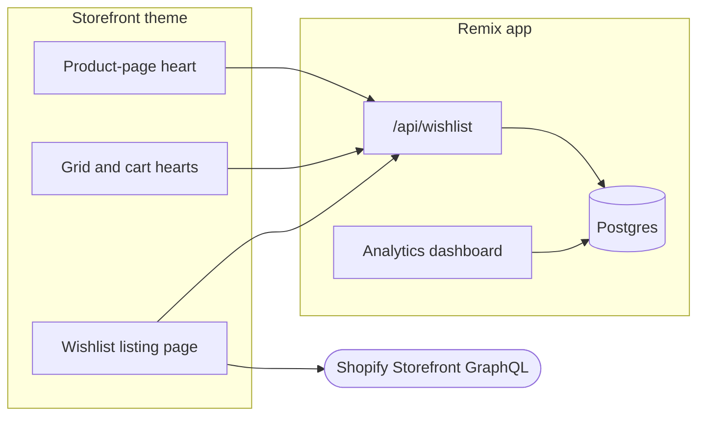

# Save for Later (WishlistFu)

> A Shopify wishlist / "save for later" app for Century Martial Arts storefronts: shoppers heart products, track notes and quantities, and merchants see aggregate wishlist analytics.

Logged-in customers can save product variants from product pages, collection grids, and the cart page. Each saved item can carry free-text notes plus **Has** / **Needs** counts (useful for gear and uniform tracking). Merchants open one embedded admin screen for cross-store wishlist analytics. The storefront UI is a theme app extension; wishlist rows live in this app's Postgres database.

If you are joining the team and need to ship changes to the live app, start here: **[docs/getting-started.md](docs/getting-started.md)**.

## How it works



Theme blocks call this app's public `/api/wishlist` route. The listing page also queries Shopify's Storefront GraphQL API directly for live price and availability. The admin dashboard is read-only aggregate reporting. Details are in [docs/architecture.md](docs/architecture.md).

## Key decisions

- **Login required for wishlist writes.** There is no guest/cookie wishlist. Guests see a login prompt on the product-page block; shared grid and cart hearts send guests to Shopify login.
- **Items are keyed by variant.** Add, remove, and notes operations match on `variantId` (with `shop` / `customerId`), not product alone.
- **Theme extension owns the shopper UI.** Product-page, listing, and shared grid/cart controls are Liquid/JS theme blocks; the Remix admin app is analytics only.
- **App URL is hardcoded in the extension.** The production backend URL is baked into the Liquid/JS today, so a hosting change means editing and redeploying the extension.
- **Internal multi-store analytics.** The dashboard loads every shop's wishlist rows into one view (with a small display-name map for known Century stores). Treat access control and distribution intent as open — see [limitations](#limitations-and-known-gaps).

## Quick start

You need Node.js matching `package.json` engines (`^18.20 || ^20.10 || >=21.0.0`), npm, Shopify CLI 3.x/4.x, Git, access to this Partners app, a development store, and a Postgres `DATABASE_URL`. Full steps: **[docs/setup.md](docs/setup.md)**. New teammates shipping to production: **[docs/getting-started.md](docs/getting-started.md)**.

```sh
git clone https://github.com/Century-Martial-Arts/wishlist-remix-app.git
cd wishlist-remix-app
npm install
npm run config:link          # link to the existing Partners app (do not create a new one)
cp .env.example .env         # then fill DATABASE_URL and any missing Shopify values
npm run setup                # prisma generate + migrate deploy
npm run dev                  # shopify app dev
```

Then enable the theme app extension blocks on the development store theme and test as a logged-in customer.

## Documentation

| Page | Read it to |
|---|---|
| [docs/getting-started.md](docs/getting-started.md) | Get access, set up locally, make a change, and ship it to the live app |
| [docs/setup.md](docs/setup.md) | Install, link the Partners app, configure env, run and test on a dev store |
| [docs/architecture.md](docs/architecture.md) | Understand the request paths, data model, design decisions and gaps |
| [docs/extensions.md](docs/extensions.md) | Theme blocks, embeds, theme hooks, and preview notes |
| [docs/api.md](docs/api.md) | Public `/api/wishlist` methods, payloads and gotchas |
| [docs/deployment.md](docs/deployment.md) | Render auto-deploy on `main`, env vars, Shopify app versions, rollback |

## Stack

| Layer | Choice |
|---|---|
| App framework | Remix 2.x (JS/JSX) + Vite |
| Admin UI | Shopify Polaris 12 + App Bridge React 4 |
| Storefront | Theme app extension (`extensions/wishlist-icon`) |
| Auth | `@shopify/shopify-app-remix` (API version January 2025 in code) |
| Database | Render-managed PostgreSQL 17 via Prisma 6 |
| Hosting | Render Docker web service (Century workspace); auto-deploy on `main` |
| Config name / handle | `WishlistFu` / `save-for-later-wishlist` (`shopify.app.toml`) |

## Configuration

See [`.env.example`](.env.example). Never commit `.env`.

| Variable | Purpose |
|---|---|
| `DATABASE_URL` | Postgres connection string for Prisma (`Session`, `Wishlist`, unused `Settings`). Production value comes from the Render-managed database and is set on the wishlist service Environment tab |
| `SHOPIFY_API_KEY` | App API key (usually provided by `shopify app dev`) |
| `SHOPIFY_API_SECRET` | App secret (usually provided by `shopify app dev`) |
| `SHOPIFY_APP_URL` | Public app URL (tunnel in local dev; production host when deployed) |
| `SCOPES` | Comma-separated scopes; should match `shopify.app.toml` |
| `SHOP_CUSTOM_DOMAIN` | Optional custom shop domain for non-`*.myshopify.com` shops |

Declared scopes in `shopify.app.toml`: `read_products`, `unauthenticated_read_product_listings`, `write_products`.

## Usage

1. **Shopper:** log in on the storefront → heart a product (product page, grid, or cart page) → open the wishlist page to review items, edit Notes/Has/Needs, or add to cart.
2. **Merchant:** open the embedded app in Shopify Admin → **Wishlist Analytics Dashboard** for totals and per-store breakdown.
3. **Developer:** change API or admin code in `app/`, change shopper UI in `extensions/wishlist-icon/`, then follow [getting started](docs/getting-started.md) to PR and release.

## Project status

The core wishlist flow and shared grid/cart hearts are in use on Century storefronts. The admin surface is a single read-only dashboard. The backend runs on Render (Docker web service + managed Postgres 17) with auto-deploy on `main`. There is no test suite, no merchant settings UI, no guest wishlist, and no GDPR mandatory webhooks registered in this repo. Leftover Fly/Litestream files remain for cleanup. See [architecture limitations](docs/architecture.md#limitations-and-known-gaps).

## Limitations and known gaps

- No guest wishlists; login is required to save.
- Production app URL is hardcoded in theme extension Liquid/JS.
- Admin dashboard is not scoped per shop; it aggregates all installed shops.
- Uninstall webhook deletes `Session` rows only; `Wishlist` rows are kept.
- No `customers/data_request`, `customers/redact`, or `shop/redact` webhooks in `shopify.app.toml`.
- Fly.io / Litestream / SQLite files in the repo are leftovers (not the production path); see [docs/deployment.md](docs/deployment.md).
- Render may still be linked to the old `UribeJr` GitHub repo — re-link to Century-Martial-Arts or auto-deploy can stop ([deployment known issue](docs/deployment.md#known-issue-github-repository-link)).

## Repo map

```text
app/routes/                 admin dashboard, wishlist API, auth, webhooks
app/shopify.server.js       Shopify app auth and session storage
app/db.server.js            Prisma client singleton
extensions/wishlist-icon/   theme app extension (blocks, assets, locales)
prisma/                     schema + PostgreSQL migration
Dockerfile                  Render production image (docker-start → migrate + serve)
shopify.app.toml            Partners app config (name, URL, scopes, webhooks)
docs/                       setup, architecture, getting started, extensions, API, deploy
APP_OVERVIEW.md             short pointer to docs (legacy overview consolidated)
master_context.md           agent-oriented gotchas; keep in sync with docs/
```
