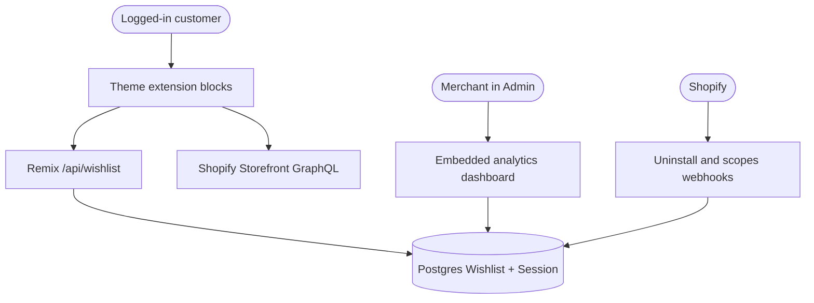
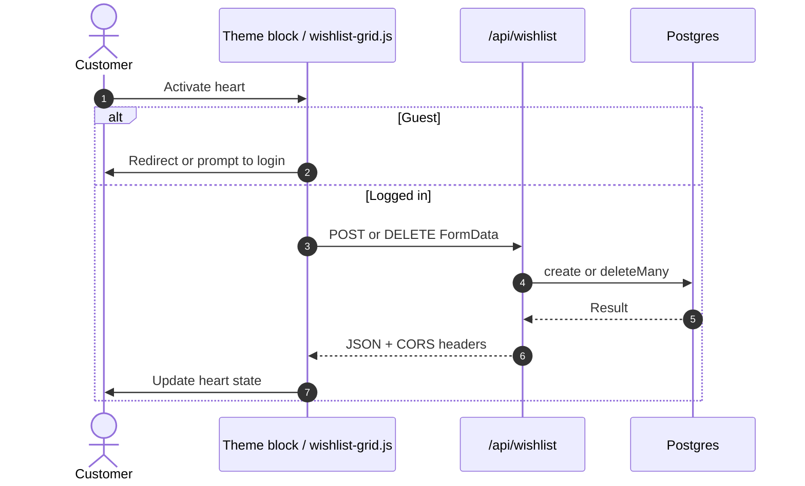
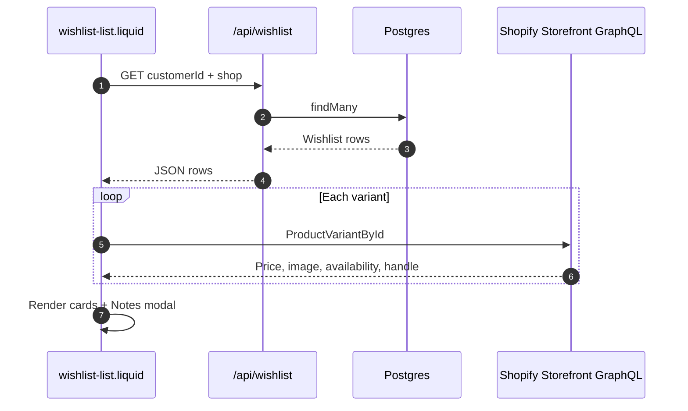
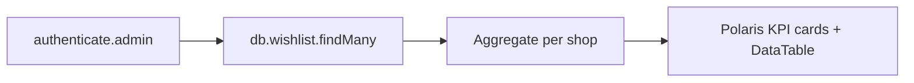
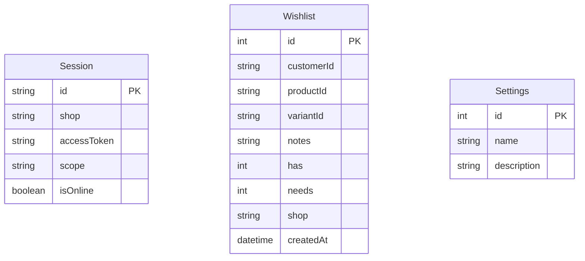

# Architecture

How the wishlist app stores and shows "save for later" items, and why it is shaped this way. For setup, see [setup.md](setup.md). For shipping, see [getting-started.md](getting-started.md) and [deployment.md](deployment.md).

The principle: **the theme extension is the shopper product; the Remix app is the API + a small analytics admin.** Wishlist rows live in this app's Postgres database. Live price and availability on the listing page come from Shopify, not from a cached product table.

## System overview

## Storefront write path

Product-page, grid, and cart hearts create or delete wishlist rows through the same public resource route.

- **Product page** (`wishlist-icon.liquid`): Alpine.js; gated with ``; reads variant from `?variant=` or the selected variant.
- **Grid and cart** (`wishlist-grid-embed.liquid` + `wishlist-grid.js`): shared controller; observes DOM mutations for AJAX-rendered cards and cart replacements; cart mounts only inside `cart-element[data-cart-page]`.
- **CORS** is intentionally open (`Access-Control-Allow-Origin: *`) so storefront origins can call the API.

Details and method table: [api.md](api.md). Block behavior: [extensions.md](extensions.md).

## Storefront read path (listing page)

Notes / Has / Needs are saved with `PUT` back to `/api/wishlist`. The listing does not use Admin GraphQL and does not go through an app proxy.

## Admin analytics path

- Single admin screen: `app/routes/app._index.jsx` ("Wishlist Analytics Dashboard").
- Nav is only **Home** (`app/routes/app.jsx`).
- Aggregation is in process (unique customers/products via sets). A small hardcoded display-name map renames known Century shops for the table; unknown shops show their `shop` domain string.
- There is **no** per-shop access filter in code: any merchant session that can open the embedded app sees the aggregate view of all rows in the connected database.

## Webhooks

Registered in `shopify.app.toml` (API version `2025-04` in toml; Remix server uses Admin API version January 2025):

| Topic | Route | Behavior |
|---|---|---|
| `app/uninstalled` | `webhooks.app.uninstalled.jsx` | Deletes `Session` rows for that shop. **Does not** delete `Wishlist` rows. |
| `app/scopes_update` | `webhooks.app.scopes_update.jsx` | Updates the session's stored `scope`. |

Mandatory GDPR topics (`customers/data_request`, `customers/redact`, `shop/redact`) are **not** registered in this repo.

## Data model

Full schema: [`prisma/schema.prisma`](../prisma/schema.prisma).

Facts that affect feature work:

- Almost every `Wishlist` column is nullable; there are no DB-level unique constraints. Dedup is application-side and incomplete (multiple rows for the same customer/variant/shop are possible if the client double-posts).
- Identity for toggles is **variant + customer + shop**.
- `customerId` is a Shopify customer id (customer PII).
- `Settings` is unused — no route reads or writes it.
- `wishlist-page.jsx` is an unfinished Remix page scaffold; the real listing is the theme block.

## Key decisions

- **Theme extension over storefront app proxy pages.** Shoppers stay in the Online Store theme. The Remix app exposes a CORS-open JSON API instead of rendering the wishlist UI.
- **Login required.** No cookie or localStorage guest list. Product-page block hides the control behind login copy; shared hearts send guests to the configured login URL.
- **Has / Needs / Notes.** Beyond a plain heart list, each row can store gear-tracking fields aimed at Century's use case.
- **Listing trusts Storefront GraphQL for merchandising fields.** The app DB stores ids and notes only, so price/availability stay current without a product sync pipeline.
- **Hardcoded production app URL in extension assets.** Simple operationally for a single hosted backend; costly if the host URL changes (requires extension edit + `shopify app deploy`).
- **Single shared database, multi-shop rows.** `shop` on each wishlist row supports several Century storefronts. The dashboard is built as an internal aggregate view.
- **Postgres in schema; Docker start runs migrations.** `docker-start` → `setup` → `remix-serve`. Older SQLite/Litestream/Fly files remain in the tree but do not match the current Prisma provider.

## Admin and dead code map

| Path | Role |
|---|---|
| `app/routes/app._index.jsx` | Live analytics dashboard |
| `app/routes/api.wishlist.jsx` | Live public API |
| `app/routes/wishlist-page.jsx` | Dead/unfinished scaffold |
| `app/routes/_index/` | Template marketing/install landing |
| `extensions/.../snippets/stars.liquid`, `thumbs-up.png` | Unused leftovers |
| `Settings` Prisma model | Unused |
| `dbsetup.js`, `litestream.yml`, Fly workflow | Leftover deploy path relative to current Postgres schema |

## Limitations and known gaps

- **No guest wishlist.**
- **Hardcoded app URL** in all active extension entrypoints.
- **No GDPR mandatory webhooks** while storing `customerId`.
- **Uninstall does not purge wishlist rows.**
- **Admin is not shop-scoped**; distribution is set to `AppDistribution.AppStore` in `shopify.server.js` even though the dashboard looks internal.
- **API gotchas:** POST ignores `has`/`needs` on create; PUT matches `customerId` + `variantId` without `shop`; missing fields often return HTTP 200 with `ok: false` (see [api.md](api.md)).
- **No automated tests.**
- **Webhook API version (toml `2025-04`) ≠ server `ApiVersion.January25`.**
- **Dockerfile Node 23** vs broader `engines` range.
- **Mixed deploy artifacts** — confirm live hosting before changing deploy code ([deployment.md](deployment.md)).

## Open questions

1. Confirm production host, deploy credentials, and whether the Fly GitHub Action is retired.
2. Confirm whether App Store distribution remains intentional.
3. Confirm compliance plan for GDPR webhooks and uninstall data retention.
4. Confirm whether PUT should be shop-scoped and whether POST should persist `has`/`needs`.
5. Confirm how many live shops are expected and whether the dashboard display-name map should stay in code.
